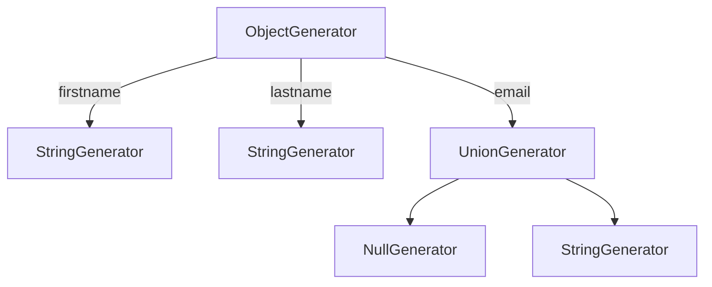

# Generator

## Introduction

This module contains code responsible for generating random samples from a given JSON Schema.
It achieves that by recursively constructing a generation tree,
where each node is responsible for a given element of JSON Schema syntax.
E.g: `NumberGenerator` class is a leaf node responsible for generating randon number inside the schema.
Similarly `ArrayGenerator` is a node that will instantiate a child node for every acceptable element type, and use them random amount of times to construct an array.

## Example Generation Tree

Let's now see how an example generation tree will look like, consider the schema below:
```json
{
    "$id": "user.json",
    "type": "object",
    "properties": {
        "firstname": {
            "type": "string"
        },
        "lastname": {
            "type": "string"
        },
        "email": {
            "type": ["string", "null"]
        }
    }
}
```
Such schema would result in the following generation tree:



## Context

The most important class inside this module is the `Context`, when we want to generate samples, we instantiate it with given settings, and invoke the `generator` method with the JSON Schema as an parameter.
The context object will then iterate all defined nodes looking for a match.
If a given node class declares compatibility with the schema context will instantiate it by passing itself alongside with the schema to its constructor.
The newly created node is then responsible for validating if the constraints defined in the schema are not contradictory, and if required extracting subschema and requesting a child node from the context object for it.

## Nodes

Each file in the `nodes` module implements a subclass of the `BaseGenerator` that implements one aspect of the JSON Schema, such as `AnyOf` keyword or an object of type integer.
It does **not** however implement references between schemas, any schema passed to the context object needs to have its references resolved by the resolver module.
Each module implementation needs to be listed inside the context in the `__init__.py` list.

## Example Usage

```python
schema = {"type": "number"}

# We instantiate context with default settings.
context = Context({})
# We construct a simple generator tree.
generator = context.generator(schema)
# We should see a random float value.
print(generator.generate())
```
